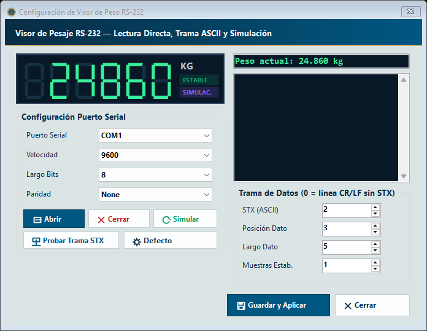
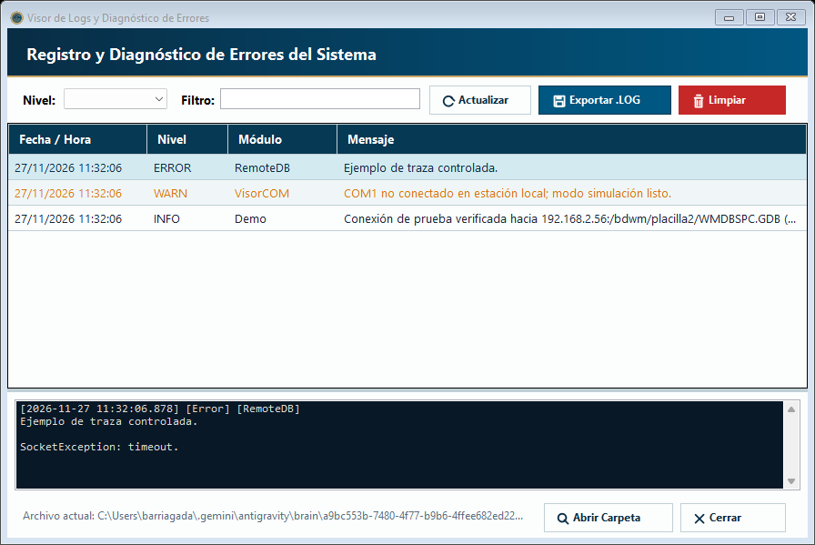

# PesajeProCamion

Sistema integral de pesaje de camiones en báscula comercial, control de peso por ejes (normativa M.O.P. Chile) y gestión administrativa de planta, migrado completamente a **.NET 10 Zero-Dependencias**, **Firebird SQL** e instalador **Inno Setup 7** (con versión **Portable Single-File** y conexión transparente a servidores locales o remotos en red).

---

## Descripción del Proyecto

**PesajeProCamion v2.0.0 LTS** unifica y moderniza los módulos operativos y administrativos heredados bajo una interfaz corporativa **Petrol Teal + Dorado**, eliminando dependencias legacy BDE/ODS 9.1, agregando resolución automática de rutas compartidas de red UNC (`\\192.168.2.56\bdwm\placilla2\WMDBSPC.GDB`), visor de báscula RS-232 en tiempo real y diagnóstico centralizado de logs de errores.

### Características Principales
- **Identidad Corporativa Petrol Teal + Logo Oficial**: Pantalla de arranque industrial (`SplashForm`), encabezado de gradiente petróleo profundo, logo oficial embebido, barra superior uniforme e íconos vectoriales High-DPI.
- **Conexión Remota en Red y Migración ODS 9.1**:
  - Modal interactivo con análisis de rutas UNC (`\\IP\recurso\archivo.GDB`), detección automática de host/dialecto/charset (`Dialecto 1` legacy o `Dialecto 3` UTF8), botón **Probar Conexión** (con latencia en `ms`, versión del servidor y conteo de pesajes), **Aplicar (Sin Cerrar)** y **Guardar y Conectar**.
  - Compatibilidad automática con esquemas remotos sin generadores ni `DBAUDITLOG` (`DatabaseCapabilities`), además de migrador binario ODS 9.1 -> Firebird UTF8 (`FileShare.ReadWrite`).
- **Visor de Báscula RS-232 (`VisorSetupForm` + LCD 7 Segmentos)**:
  - Soporta tramas con `STX` (`PosData`/`LenData`) y tramas ASCII delimitadas por línea (`STX = 0`), inyección de tramas de prueba, simulación (`/TEST`) y curva dinámica `DEMO1`.
- **Pesaje Comercial y Control de Ejes M.O.P.**:
  - Flujo completo **Pesar Camión** / **Pesar Carro / 2° Peso** / **Tara Registrada** (vigencia `NDIAS`) / **Grabar Pesaje**, autoresolución de códigos al salir del campo y evaluación normativa Decreto 158/80 y Ley 19.171/92.
- **Impresión, Exportación Nativa e Informes**:
  - Selector de **Nro de Copias**, ticket comercial gráfico con logotipo y totales en grilla (**Bruto / Tara / Neto**), exportación nativa sin Excel instalado a `.xlsx` (OpenXML), `.dbf` (dBASE III) y `.csv` UTF-8 BOM, y 11 informes operativos y de diagnóstico.
- **Trazabilidad y Logs de Errores (`ErrorLogViewerDialog`)**:
  - Captura global de excepciones UI/asíncronas, eventos SQL y tramas RS-232 con exportación directa `.log`.
- **Cero Dependencias (Instalador + Portable)**:
  - Compilación autocontenida `.NET 10 win-x64` tanto en instalador **Inno Setup 7** como en edición **Portable Single-File** sin instalación previa.

---

## Capturas

| Pantalla de Arranque Corporativa | Inicio de Sesión y Acceso BD/Logs |
| :---: | :---: |
|  |  |

| Panel de Pesaje Comercial y Visor RS-232 | Conexión Remota BD y Migrador |
| :---: | :---: |
|  |  |

| Visor RS-232 / Tramas ASCII | Visor de Logs de Errores |
| :---: | :---: |
|  |  |

---

## Requisitos

### Equipos Finales (Cero Dependencias)
- **Windows 10 / Windows 11 (64 bits)**.
- **No requiere instalar .NET Runtime** (distribución autocontenida en Instalador y Portable).
- Conectividad hacia servidor **Firebird / InterBase** (local `localhost:3050` o equipo remoto en red TCP `3050`).

### Desarrollo y Empaquetado
- **Windows 10 / 11 (x64)**
- **.NET 10 SDK** (`10.0.100+` Windows Desktop)
- **Firebird 2.5+** para pruebas de integración
- **Inno Setup 7** (`ISCC.exe`)

---

## Instalación

### Opción 1 — Instalador Windows (Inno Setup 7)
Descargue `PesajeProCamion_Setup_v2.0.0.exe` y ejecute el asistente (admite actualización directa conservando datos y configuración):
```powershell
PesajeProCamion_Setup_v2.0.0.exe /VERYSILENT /SUPPRESSMSGBOXES /NORESTART
```

### Opción 2 — Edición Portable Zero-Dependencias
Descomprima `PesajeProCamion_Portable_v2.0.0_win-x64.zip` y ejecute `PesajeProCamion.App.exe` directamente sin instalar ni requerir permisos administrativos. Con `portable.flag` o `appsettings.json` junto al ejecutable, la configuración y los archivos `Logs\` se conservan de forma portable.

---

## Configuración y Conexión a BD Remota

1. En **Login** (`Servidor BD`) o en la barra superior principal (**Configurar Servidor BD...**), ingrese la ruta de red UNC (ej: `\\192.168.2.56\bdwm\placilla2\WMDBSPC.GDB`) o servidor + ruta local.
2. Presione **Probar Conexión** para resolver automáticamente host, candidato de ruta remota, dialecto (`1` legacy / `3` moderno) y latencia.
3. Presione **Aplicar (Sin Cerrar)** o **Guardar y Conectar**.

Diagnóstico o migración rápida desde consola:
```powershell
# Probar conexión remota UNC por línea de comandos
PesajeProCamion.App.exe --probe "\\192.168.2.56\bdwm\placilla2\WMDBSPC.GDB"

# Migrar archivo legacy ODS 9.1 hacia base moderna Firebird UTF8
PesajeProCamion.App.exe --migrate "D:\ruta\WMDBSPC.GDB" "C:\ProgramData\PesajeProCamion\Data\WMDBSPC.FDB"
```

---

## Uso y Compilación Rápida

```powershell
# Compilar en Debug y Release (0 errores, 0 advertencias)
dotnet build PesajeProCamion.sln -c Debug
dotnet build PesajeProCamion.sln -c Release

# Ejecutar suite completa (Unit, Integration, Network UNC, Functional, UI, Stress)
dotnet test PesajeProCamion.sln -c Release --no-build

# Generar Instalador + Edición Portable autocontenidos
dotnet publish src\PesajeProCamion.App\PesajeProCamion.App.csproj -c Release -r win-x64 --self-contained true -o publish\win-x64
& "$env:LOCALAPPDATA\Programs\Inno Setup 7\ISCC.exe" installer\PesajeProCamion.iss
dotnet publish src\PesajeProCamion.App\PesajeProCamion.App.csproj -c Release -r win-x64 --self-contained true -p:PublishSingleFile=true -p:IncludeNativeLibrariesForSelfExtract=true -p:EnableCompressionInSingleFile=true -o publish\portable-win-x64
```

Documentación detallada en `docs/`:
- [Auditoría Legacy](docs/AUDITORIA_LEGACY.md)
- [Arquitectura Técnica](docs/ARQUITECTURA.md)
- [Manual Funcional](docs/MANUAL_FUNCIONAL.md)
- [Guía de Compilación](docs/COMPILACION.md)
- [Guía de Despliegue y Conexión Remota](docs/DESPLIEGUE.md)

---

## Versionado e Historial de Cambios

Versionado semántico (`MAJOR.MINOR.PATCH`). Versión actual: **`2.0.0`**.
Ver historial completo en [CHANGELOG.md](CHANGELOG.md).

## Créditos

PesajeProCamion — Plataforma industrial de pesaje vehicular y control de ejes M.O.P. sobre **.NET 10** y **Firebird SQL**.
