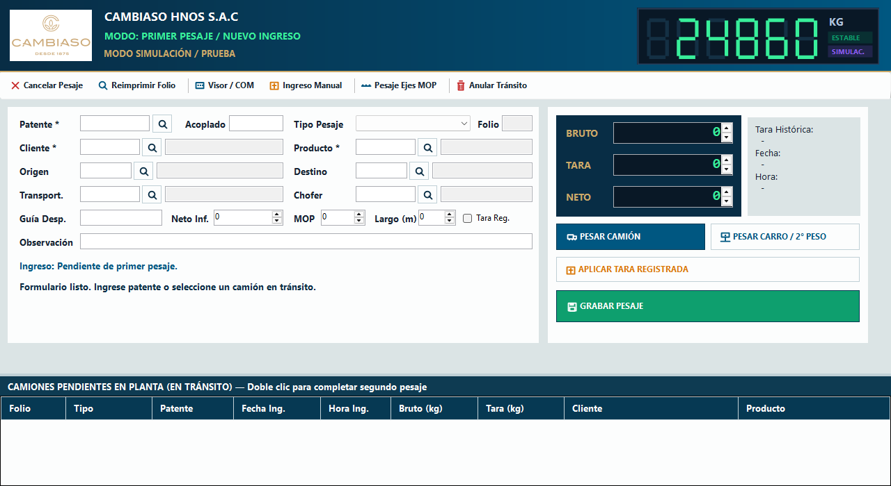
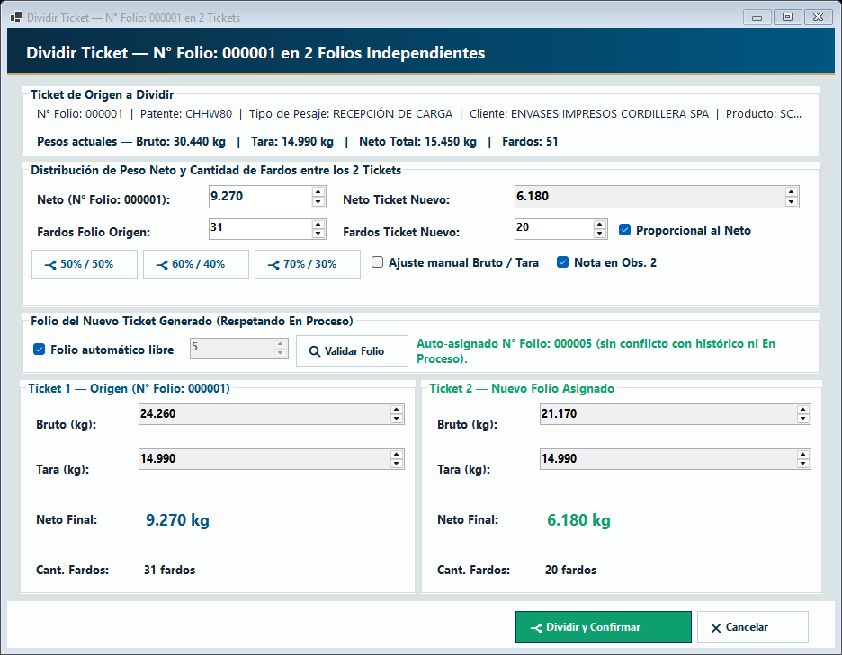
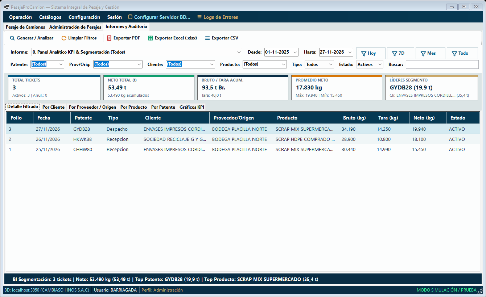
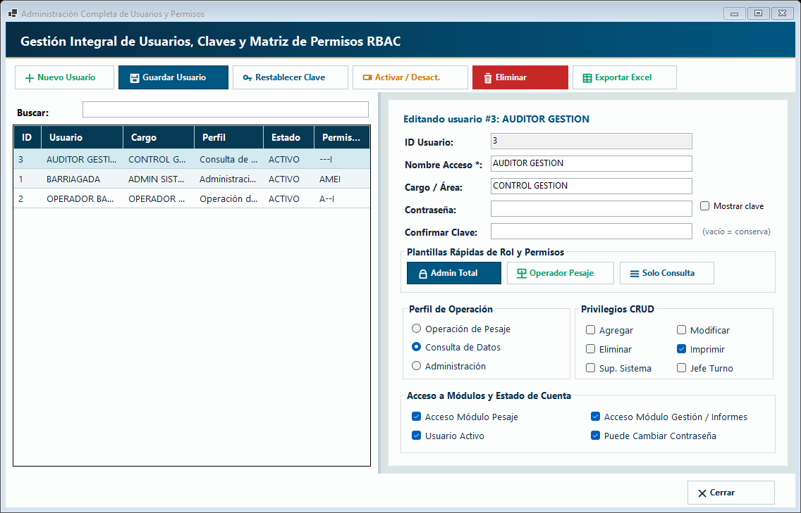
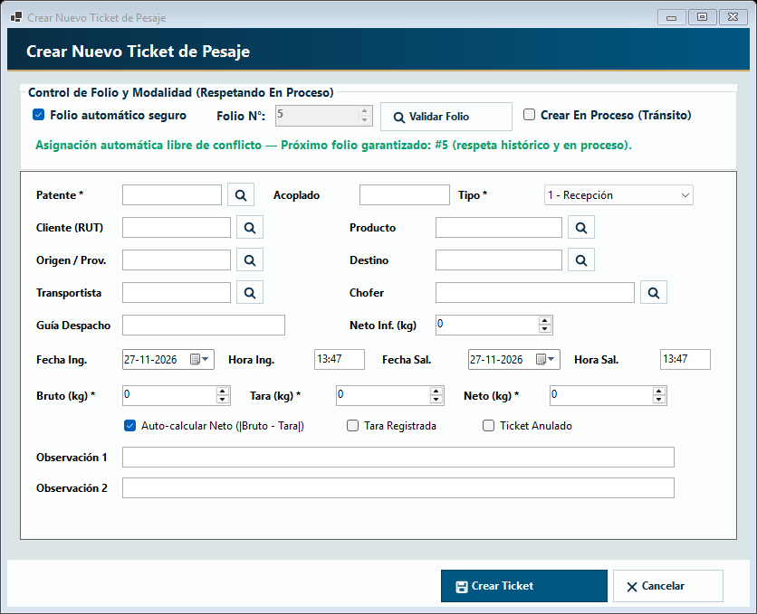

# PesajeProCamion

Sistema integral de pesaje de camiones en báscula comercial, control de peso por ejes (normativa M.O.P. Chile), gestión administrativa CRUD de tickets/usuarios y analítica BI en planta, desarrollado sobre **.NET 10 Zero-Dependencias**, **Firebird SQL** e instalador **Inno Setup 7** (con versión **Portable Single-File** y conexión transparente a servidores locales o remotos en red).

---

## Descripción del Proyecto

**PesajeProCamion v2.4.0** unifica y moderniza la operación completa de romana y administración bajo una interfaz corporativa **Petrol Teal + Dorado** 100% responsiva (validada desde `1024x700` hasta `4K`), eliminando dependencias legacy BDE/ODS 9.1, conectándose a bases locales o compartidas en red (`\\192.168.2.56\bdwm\placilla2\WMDBSPC.GDB`), protegiendo folios contra colisiones e incorporando personalización completa de tickets (**Estado**, **Cantidad de Fardos**, **`N° Folio: xxxxxx`**, **`Tipo de Pesaje`** y jerarquía visual **Neto**), división en 2 folios, menús contextuales universales, exportación estandarizada **PDF + Excel `.xlsx` + Impresión**, manejo de errores con **IDs de correlación**, sanitización de credenciales y logs rotativos.

### Características Principales
- **Visor Personalizable y Editor en Vivo de Tickets (`TicketViewerDialog`)**:
  - **Checkboxes por campo** para mostrar u ocultar libremente *Patente, Cliente, Producto, Origen/Proveedor, Destino, Transportista, Chofer, Guía de Despacho, Cant. de Fardos, Estado, Fechas/Operador y Observaciones* (con persistencia en `appsettings.json` aplicada a Visor, Vista Previa, Impresión, PDF, Excel `.xlsx` y Copia de Texto sin borrar datos en Firebird).
  - **Encabezado estandarizado**: **`N° Folio: xxxxxx`** en negrita (preservando ceros iniciales), **`Tipo de Pesaje: RECEPCIÓN DE CARGA / DESPACHO DE CARGA / MOVIMIENTO INTERNO`** destacado sin recortes, **Bruto/Tara** en negrita y **Neto** en negrita con fuente mayor.
- **Cantidad de Fardos, CRUD sin Conflictos de Folio y División en 2 (`TicketEditorDialog` + `SplitTicketDialog`)**:
  - Ingreso numérico no negativo de **Cantidad de Fardos** (`Fardos`) con checkbox de visualización en formularios, grillas, reportes y exportaciones, además de migración idempotente compatible con BD remotas ODS 9 sin dicha columna.
  - Ingreso manual independiente de **Bruto**, **Tara** y **Neto** (con auto-cálculo opcional).
  - **División automática de Tickets en 2 folios** (ej.: Folio `#1` Neto `10` -> Folio `#1` Neto `6` + nuevo Folio `#2` Neto `4`, con reparto proporcional y validación explícita de fardos), respetando históricos y vehículos **En Proceso**.
- **Gestión Completa de Usuarios y Seguridad RBAC (`UsuariosForm`)**:
  - Cuenta administradora principal **`barriagada`** (clave inicial **`Cambias0`**) garantizada en inicialización y migración; validaciones RBAC en UI y capa de guardado.
  - CRUD completo, restablecimiento de clave con visor mostrar/ocultar, plantillas (**Admin Total / Operador Pesaje / Solo Consulta**), permisos granulares y protección del último administrador activo.
- **Menús Contextuales Universales (`UniversalContextMenuService`)**:
  - Clic derecho estandarizado en **Camiones en Tránsito**, **Administración de Pesajes**, **Informes BI y Gráficos**, **Usuarios**, **Pesaje Ejes MOP**, **Logs**, **Catálogos** y **Búsquedas**, mostrando solo acciones válidas según selección y permisos RBAC.
- **Centro Analítico BI, Exportación Estandarizada a Página Completa (PDF / Excel `.xlsx` / Impresión)**:
  - Panel de **Informes y Auditoría** con filtro `DatePicker` (**Hoy / 7D / Mes / Todo**), segmentadores reactivos (**Patente, Proveedor/Origen, Cliente, Producto, Tipo, Estado, Búsqueda**), 5 tarjetas **KPI**, pestañas segmentadas, **Gráficos KPI** nativos y 11 informes operativos.
  - Salidas unificadas (`StandardTableReport`) **cero-dependencias** en **Impresión**, **PDF** corporativo (`PdfDocumentWriter`) con encabezados repetidos/totales y **Excel `.xlsx`** (`Print_Titles`, ajuste a página, formato `000000`/`#,##0`, libro BI de 6 hojas), además de `.dbf` y `.csv`.
- **Conexión Remota en Red, Visor RS-232 y Cero Dependencias**:
  - Modal de BD Remota (`RemoteDatabaseResolver` + `DatabaseCapabilities`) para rutas UNC/IP (`\\192.168.2.56\bdwm\placilla2\WMDBSPC.GDB`), migrador ODS 9.1, visor COM1..COM16 (`STX=0`), simulación `/TEST` y logs (`ErrorLogViewerDialog`).

---

## Capturas

| Pantalla de Arranque Corporativa | Inicio de Sesión y Acceso BD/Logs |
| :---: | :---: |
|  |  |

| Panel de Pesaje Comercial y Visor RS-232 | Administración de Pesajes (CRUD + Dividir + Clic Derecho) |
| :---: | :---: |
|  |  |

| Visor Personalizable de Ticket (Checkboxes + Edición en Vivo) | División de Ticket en 2 Folios sin Colisión |
| :---: | :---: |
|  |  |

| Centro Analítico BI KPI y Segmentación | Gestión Integral de Usuarios y RBAC |
| :---: | :---: |
|  |  |

| Editor / Creador Manual de Ticket (Bruto/Tara/Neto Manual) | Conexión Remota BD y Migrador |
| :---: | :---: |
|  |  |

---

## Requisitos

### Equipos Finales (Cero Dependencias)
- **Windows 10 / Windows 11 (64 bits)**, resolución mínima recomendada `1024x700`.
- **No requiere instalar .NET Runtime ni Excel** (compilación autocontenida con motores nativos OpenXML `.xlsx` y PDF 1.4 integrados).
- Conectividad hacia servidor **Firebird / InterBase** (local `localhost:3050` o equipo remoto en red TCP `3050`).

### Desarrollo y Empaquetado
- **Windows 10 / 11 (x64)**
- **.NET 10 SDK** (`10.0.100+` Windows Desktop)
- **Firebird 2.5+** para pruebas de integración
- **Inno Setup 7** (`ISCC.exe`)

---

## Instalación

### Opción 1 — Instalador Windows (Inno Setup 7)
Descargue `PesajeProCamion_Setup_v2.4.0.exe` desde la sección **Releases** de GitHub y ejecute el asistente (actualiza versiones anteriores conservando configuración y datos):
```powershell
PesajeProCamion_Setup_v2.4.0.exe /VERYSILENT /SUPPRESSMSGBOXES /NORESTART
```

### Opción 2 — Edición Portable Zero-Dependencias
Descomprima `PesajeProCamion_Portable_v2.4.0_win-x64.zip` y ejecute `PesajeProCamion.App.exe` directamente sin instalar ni requerir privilegios administrativos. Con `portable.flag` o `appsettings.json` junto al ejecutable, la configuración y los archivos `Logs\` se conservan junto al binario.

---

## Configuración y Acceso Inicial

- **Usuario administrador predeterminado**: `barriagada` / contraseña: `Cambias0` (administración completa desde *Configuración -> Usuarios y Permisos...*).
- **Conexión BD local o remota**: En **Login** (`Servidor BD`) o en la barra superior principal (**Configurar Servidor BD...**), ingrese la ruta UNC compartida (ej.: `\\192.168.2.56\bdwm\placilla2\WMDBSPC.GDB`), presione **Probar Conexión** y guarde con **Aplicar (Sin Cerrar)** o **Guardar y Conectar**.

```powershell
# Probar conexión remota UNC por línea de comandos
PesajeProCamion.App.exe --probe "\\192.168.2.56\bdwm\placilla2\WMDBSPC.GDB"

# Migrar archivo legacy ODS 9.1 hacia base moderna Firebird UTF8
PesajeProCamion.App.exe --migrate "D:\ruta\WMDBSPC.GDB" "C:\ProgramData\PesajeProCamion\Data\WMDBSPC.FDB"
```

---

## Uso y Compilación Rápida

```powershell
# Compilar en Debug y Release (0 errores, 0 advertencias)
dotnet build PesajeProCamion.sln -c Debug
dotnet build PesajeProCamion.sln -c Release

# Ejecutar suite completa (Unit, Integration, Network UNC, Functional, UI, Stress)
dotnet test PesajeProCamion.sln -c Release --no-build

# Generar Instalador + Edición Portable autocontenidos
dotnet publish src\PesajeProCamion.App\PesajeProCamion.App.csproj -c Release -r win-x64 --self-contained true -o publish\win-x64
& "$env:LOCALAPPDATA\Programs\Inno Setup 7\ISCC.exe" installer\PesajeProCamion.iss
dotnet publish src\PesajeProCamion.App\PesajeProCamion.App.csproj -c Release -r win-x64 --self-contained true -p:PublishSingleFile=true -p:IncludeNativeLibrariesForSelfExtract=true -p:EnableCompressionInSingleFile=true -o publish\portable-win-x64
```

Documentación detallada en `docs/`:
- [Auditoría Legacy](docs/AUDITORIA_LEGACY.md)
- [Arquitectura Técnica](docs/ARQUITECTURA.md)
- [Manual Funcional](docs/MANUAL_FUNCIONAL.md)
- [Guía de Compilación](docs/COMPILACION.md)
- [Guía de Despliegue y Conexión Remota](docs/DESPLIEGUE.md)

---

## Ubicación de Configuración, Logs y Datos
- **Modo Instalado**: Configuración de servidor BD y preferencias visuales (`appsettings.json`) en `%LocalAppData%\PesajeProCamion\`; logs de diagnóstico en `%LocalAppData%\PesajeProCamion\Logs\`; base Firebird local por defecto en `%ProgramData%\PesajeProCamion\Data\WMDBSPC.FDB`.
- **Modo Portable**: Si existe `portable.flag` junto a `PesajeProCamion.App.exe`, tanto `appsettings.json` como `Logs\` permanecen junto al binario sin tocar el registro del sistema.

---

## Solución de Problemas Frecuentes
- **Error de red o ruta UNC en BD remota**: Use el botón **Servidor BD** -> **Analizar Ruta Red** y **Probar Conexión**; verifique que el puerto TCP `3050` de Firebird esté abierto en el equipo servidor y que los logs (`Visor de Logs y Diagnóstico`) no indiquen bloqueo de firewall.
- **Bases Firebird ODS 9 heredadas sin columnas recientes (`FARDOS`, `ID_LOG`, auditoría)**: `DatabaseCapabilities` adapta las consultas automáticamente en modo de solo lectura/escritura segura sin alterar el esquema remoto.

---

## Versionado e Historial de Cambios

Versionado semántico (`MAJOR.MINOR.PATCH`). Versión actual: **`2.4.0`**.
Ver historial completo en [CHANGELOG.md](CHANGELOG.md).

## Créditos

PesajeProCamion — Plataforma industrial de pesaje vehicular, control de ejes M.O.P. y analítica BI sobre **.NET 10** y **Firebird SQL**.
