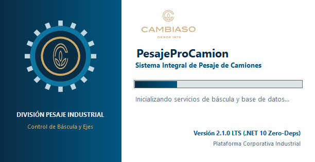
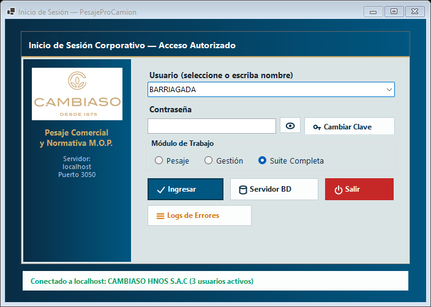
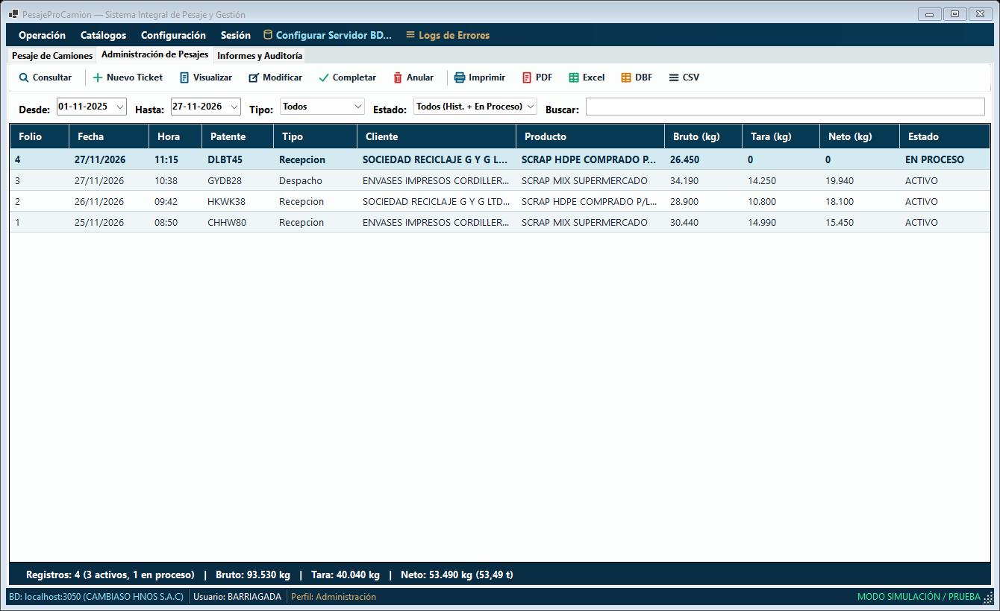

# PesajeProCamion

Sistema integral de pesaje de camiones en báscula comercial, control de peso por ejes (normativa M.O.P. Chile), gestión administrativa CRUD de tickets/usuarios y analítica BI en planta, desarrollado sobre **.NET 10 Zero-Dependencias**, **Firebird SQL** e instalador **Inno Setup 7** (con versión **Portable Single-File** y conexión transparente a servidores locales o remotos en red).

---

## Descripción del Proyecto

**PesajeProCamion v2.1.0 LTS** unifica y moderniza la operación completa de romana y administración bajo una interfaz corporativa **Petrol Teal + Dorado** 100% responsiva (validada desde `1024x700` hasta `4K`), eliminando dependencias legacy BDE/ODS 9.1, conectándose a bases locales o compartidas en red (`\\192.168.2.56\bdwm\placilla2\WMDBSPC.GDB`), protegiendo folios contra colisiones e incorporando inteligencia de negocio (KPI, segmentación y exportación nativa a PDF y Excel `.xlsx`).

### Características Principales
- **Identidad Corporativa Petrol Teal + Logo Oficial**: Pantalla de arranque industrial (`SplashForm`), encabezados con gradiente petróleo profundo, logotipo oficial embebido, tema uniforme y botones vectoriales High-DPI sin recortes ni desbordes.
- **Gestión Completa de Usuarios y Seguridad RBAC (`UsuariosForm`)**:
  - Cuenta administradora principal **`barriagada`** (clave inicial **`Cambias0`**) garantizada en inicialización y migración.
  - CRUD completo de operadores/administradores, restablecimiento de clave con visor mostrar/ocultar, plantillas de rol (**Admin Total / Operador Pesaje / Solo Consulta**), permisos granulares (`Agregar`, `Modificar`, `Eliminar`, `Imprimir`, acceso por módulo), protección contra eliminación del último administrador activo y menú contextual clic derecho.
- **CRUD Completo de Tickets y Visor Gráfico sin Conflictos de Folio (`TicketEditorDialog` + `TicketViewerDialog`)**:
  - Creación de tickets manuales históricos (`DBPESAJES`) o En Proceso (`DBTRANSITO`) y edición segura de registros existentes o pendientes en planta.
  - Verificación en vivo de folios disponibles (`CheckFolioAvailabilityAsync`) respetando estrictamente los folios activos **En Proceso**.
  - Visor gráfico interactivo del ticket con logotipo, estado (`COMPLETADO / EN PROCESO / ANULADO`), selector de copias, previsualización/impresión y exportación directa de ticket a PDF.
- **Menús Contextuales por Clic Derecho (`ContextMenuStrip`)**:
  - Clic derecho en **Camiones en Tránsito**, **Administración de Pesajes**, **Gestión de Usuarios**, **Detalle BI** y **Diálogos de Búsqueda** para visualizar, modificar, duplicar, completar salida, anular/reactivar, exportar a PDF o copiar datos al instante.
- **Centro Analítico BI, KPIs y Exportación Nativa PDF + Excel (`.xlsx`)**:
  - Panel de **Informes y Auditoría** con filtro `DatePicker` (`Desde` / `Hasta`), accesos rápidos (**Hoy / 7D / Mes / Todo**), segmentadores reactivos (**Patente, Proveedor/Origen, Cliente, Producto, Tipo, Estado, Búsqueda**), 5 tarjetas **KPI**, pestañas por segmento, **Gráficos KPI** nativos y 11 informes operativos clásicos.
  - Exportación **sin dependencias externas** (no requiere Microsoft Excel ni librerías externas) a **PDF** corporativo (`PdfDocumentWriter`) y libro **Excel `.xlsx` multi-hoja** (KPIs + Detalle + Segmentación por Cliente, Proveedor, Producto y Patente), además de **`.dbf`** y **`.csv`**.
- **Conexión Remota en Red, Visor RS-232 y Trazabilidad de Errores**:
  - Modal de BD Remota (`RemoteDatabaseResolver` + `DatabaseCapabilities`) para rutas UNC/IP (`\\192.168.2.56\bdwm\placilla2\WMDBSPC.GDB`), autodetección Dialecto `1/3` y migrador ODS 9.1 `.GDB -> .FDB` (`FileShare.ReadWrite`).
  - Visor RS-232 COM1..COM16 (`STX > 0` o `CR/LF` con `STX = 0`), simulación `/TEST`, curva dinámica M.O.P. `DEMO1` y visor en vivo de logs (`ErrorLogViewerDialog`).
- **Cero Dependencias (Instalador Inno Setup 7 + Portable Single-File)**:
  - Distribución autocontenida `.NET 10 win-x64` lista para ejecutar en Windows 10/11 limpio.

---

## Capturas

| Pantalla de Arranque Corporativa | Inicio de Sesión y Acceso BD/Logs |
| :---: | :---: |
|  |  |

| Panel de Pesaje Comercial y Visor RS-232 | Administración de Pesajes (CRUD + Clic Derecho) |
| :---: | :---: |
|  |  |

| Centro Analítico BI KPI y Segmentación | Gestión Integral de Usuarios y RBAC |
| :---: | :---: |
|  |  |

| Visor Gráfico de Ticket Comercial | Editor / Creador Manual de Ticket sin Colisión |
| :---: | :---: |
|  |  |

| Conexión Remota BD y Migrador | Visor RS-232 / Tramas ASCII |
| :---: | :---: |
|  |  |

---

## Requisitos

### Equipos Finales (Cero Dependencias)
- **Windows 10 / Windows 11 (64 bits)**, resolución mínima recomendada `1024x700`.
- **No requiere instalar .NET Runtime ni Excel** (compilación autocontenida con motores nativos OpenXML `.xlsx` y PDF 1.4 integrados).
- Conectividad hacia servidor **Firebird / InterBase** (local `localhost:3050` o equipo remoto en red TCP `3050`).

### Desarrollo y Empaquetado
- **Windows 10 / 11 (x64)**
- **.NET 10 SDK** (`10.0.100+` Windows Desktop)
- **Firebird 2.5+** para pruebas de integración
- **Inno Setup 7** (`ISCC.exe`)

---

## Instalación

### Opción 1 — Instalador Windows (Inno Setup 7)
Descargue `PesajeProCamion_Setup_v2.1.0.exe` desde la sección **Releases** de GitHub y ejecute el asistente (actualiza versiones anteriores conservando configuración y datos):
```powershell
PesajeProCamion_Setup_v2.1.0.exe /VERYSILENT /SUPPRESSMSGBOXES /NORESTART
```

### Opción 2 — Edición Portable Zero-Dependencias
Descomprima `PesajeProCamion_Portable_v2.1.0_win-x64.zip` y ejecute `PesajeProCamion.App.exe` directamente sin instalar ni requerir privilegios administrativos. Con `portable.flag` o `appsettings.json` junto al ejecutable, la configuración y los archivos `Logs\` se conservan junto al binario.

---

## Configuración y Acceso Inicial

- **Usuario administrador predeterminado**: `barriagada` / contraseña: `Cambias0` (puede iniciar sesión seleccionando el usuario o escribiéndolo directamente; desde *Configuración -> Usuarios y Permisos...* puede administrar todos los usuarios, claves y privilegios).
- **Conexión BD local o remota**: En **Login** (`Servidor BD`) o en la barra superior principal (**Configurar Servidor BD...**), ingrese la ruta UNC compartida (ej.: `\\192.168.2.56\bdwm\placilla2\WMDBSPC.GDB`), presione **Probar Conexión** y guarde con **Aplicar (Sin Cerrar)** o **Guardar y Conectar**.

Diagnóstico o migración rápida desde consola:
```powershell
# Probar conexión remota UNC por línea de comandos
PesajeProCamion.App.exe --probe "\\192.168.2.56\bdwm\placilla2\WMDBSPC.GDB"

# Migrar archivo legacy ODS 9.1 hacia base moderna Firebird UTF8
PesajeProCamion.App.exe --migrate "D:\ruta\WMDBSPC.GDB" "C:\ProgramData\PesajeProCamion\Data\WMDBSPC.FDB"
```

---

## Uso y Compilación Rápida

```powershell
# Compilar en Debug y Release (0 errores, 0 advertencias)
dotnet build PesajeProCamion.sln -c Debug
dotnet build PesajeProCamion.sln -c Release

# Ejecutar suite completa (Unit, Integration, Network UNC, Functional, UI, Stress)
dotnet test PesajeProCamion.sln -c Release --no-build

# Generar Instalador + Edición Portable autocontenidos
dotnet publish src\PesajeProCamion.App\PesajeProCamion.App.csproj -c Release -r win-x64 --self-contained true -o publish\win-x64
& "$env:LOCALAPPDATA\Programs\Inno Setup 7\ISCC.exe" installer\PesajeProCamion.iss
dotnet publish src\PesajeProCamion.App\PesajeProCamion.App.csproj -c Release -r win-x64 --self-contained true -p:PublishSingleFile=true -p:IncludeNativeLibrariesForSelfExtract=true -p:EnableCompressionInSingleFile=true -o publish\portable-win-x64
```

Documentación detallada en `docs/`:
- [Auditoría Legacy](docs/AUDITORIA_LEGACY.md)
- [Arquitectura Técnica](docs/ARQUITECTURA.md)
- [Manual Funcional](docs/MANUAL_FUNCIONAL.md)
- [Guía de Compilación](docs/COMPILACION.md)
- [Guía de Despliegue y Conexión Remota](docs/DESPLIEGUE.md)

---

## Versionado e Historial de Cambios

Versionado semántico (`MAJOR.MINOR.PATCH`). Versión actual: **`2.1.0`**.
Ver historial completo en [CHANGELOG.md](CHANGELOG.md).

## Créditos

PesajeProCamion — Plataforma industrial de pesaje vehicular, control de ejes M.O.P. y analítica BI sobre **.NET 10** y **Firebird SQL**.
