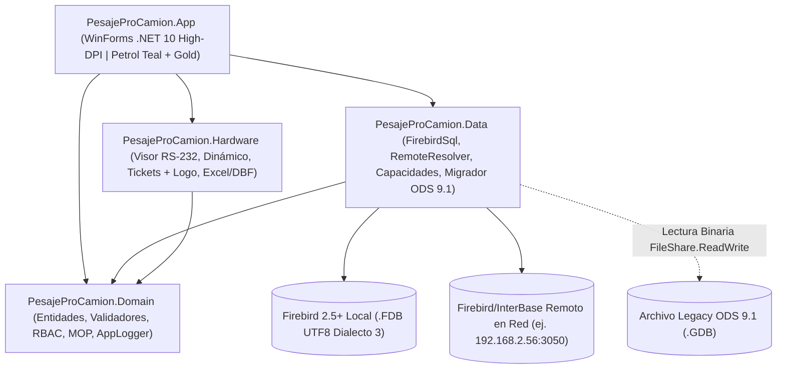

# Arquitectura Técnica — PesajeProCamion (.NET 10)

## 1. Diagrama de Capas

## 2. Proyectos de la Solución

| Proyecto | Responsabilidad |
| :--- | :--- |
| `PesajeProCamion.Domain` | Entidades puras, validadores chilenos Módulo 11 y patentes (`ChileanValidators`), cálculos comerciales y normativa MOP (`WeighingCalculator`), hashing `PBKDF2-SHA256` (`PasswordHasher`), RBAC (`PermissionService`) y sistema centralizado de logs (`AppLogger`). |
| `PesajeProCamion.Data` | `RemoteDatabaseResolver` para rutas UNC de red y TCP 3050, detección automática de capacidades `DatabaseCapabilities` (soporta indistintamente esquema moderno UTF8 y esquema legacy remoto ODS 9.1 Dialecto 1 sin generadores ni `DBAUDITLOG`), `FirebirdSchemaManager`, `Ods9BinaryReader` y `Ods9Migrator`. |
| `PesajeProCamion.Hardware` | Parser serial `SerialFrameParser` (modos STX + CR/LF sin STX), monitor/simulador `ScaleReaderService`, algoritmo dinámico `DynamicAxleProcessor`, impresión gráfica/RAW de tickets con logotipo (`TicketPrinterService`) y exportación nativa `.xlsx`/`.dbf`/`.csv` (`DataExporter`). |
| `PesajeProCamion.App` | Tema corporativo Petrol Teal + Dorado (`AppTheme`, `IconCatalog`), `SplashForm`, `LoginForm`, `DatabaseConnectionForm` (Probar / Aplicar / Guardar), `ErrorLogViewerDialog`, `VisorSetupForm`, `PesajeWorkspaceControl`, `PesajeMopForm`, `GestionPesajesControl`, `ReportsWorkspaceControl` y catálogos CRUD. |
| `PesajeProCamion.Tests` | Suite xUnit automatizada: unitarias, integración real (Firebird local + prueba UNC remota), funcionales, auditoría STA UI y rendimiento. |
