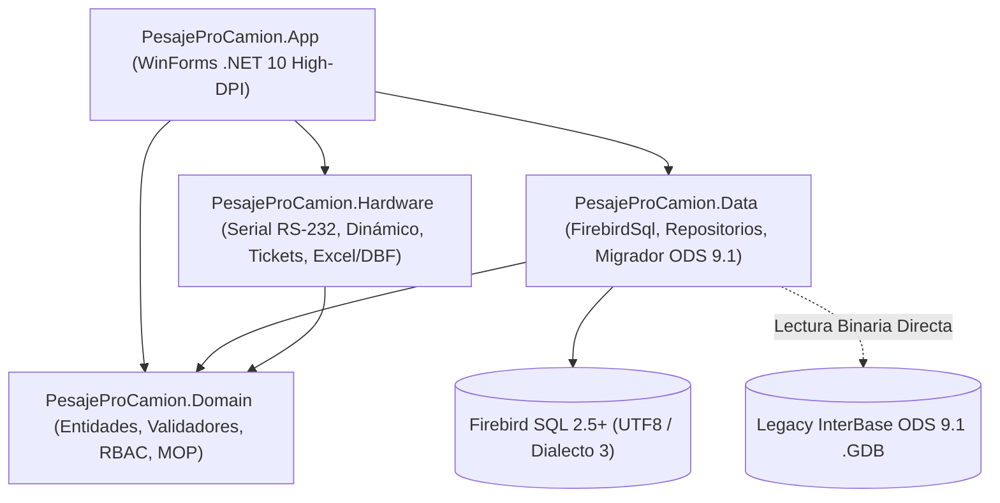

# Arquitectura Técnica — PesajeProCamion (.NET 10)

## 1. Diagrama de Capas

---

## 2. Descripción de Proyectos

| Proyecto | Responsabilidad |
| :--- | :--- |
| `PesajeProCamion.Domain` | Modelos puros (`Pesaje`, `Camion`, `Cliente`, `Usuario`, `PesajeMop`), validadores chilenos Módulo 11 (`ChileanValidators`), cálculos de neto/tara/MOP (`WeighingCalculator`), hashing `PBKDF2-SHA256` (`PasswordHasher`) y matriz RBAC (`PermissionService`). |
| `PesajeProCamion.Data` | Gestión de esquema (`FirebirdSchemaManager`), lector binario `Ods9BinaryReader`, migrador `Ods9Migrator`, repositorios parametrizados (`CatalogRepository`, `SecurityRepository`, `WeighingRepository`, `MopRepository`). |
| `PesajeProCamion.Hardware` | Parser serial configurable (`SerialFrameParser`), lector/simulador RS-232 (`ScaleReaderService`), algoritmo dinámico (`DynamicAxleProcessor`), tickets RAW y gráficos (`TicketPrinterService`) y exportación nativa `.xlsx`/`.dbf`/`.csv` (`DataExporter`). |
| `PesajeProCamion.App` | Interfaz WinForms unificada High-DPI (`MainShellForm`), visor digital 7-segmentos (`DigitalWeightDisplay`), iconos vectoriales consistentes (`IconCatalog`), catálogos CRUD, operación comercial/MOP e informes. |
| `PesajeProCamion.Tests` | Suite xUnit automatizada: pruebas unitarias, integración real sobre Firebird 2.5 + `.GDB`, funcionales, auditoría UI STA y pruebas de estrés. |

---

## 3. Modelo de Seguridad (RBAC)

- **Contraseñas**: Derivadas con `PBKDF2-SHA256`, 100,000 iteraciones y salt aleatorio de 16 bytes; comparación en tiempo constante (`CryptographicOperations.FixedTimeEquals`).
- **Control de Acceso**: Toda operación valida `PermissionService.EstaAutorizado(usuario, AccionAutorizacion)`:
  - `PerfilOperacion.Administracion (2)` o `SupervisorSistema`: acceso total, usuarios y parámetros críticos.
  - `PerfilOperacion.OperacionPesaje (0)`: pesaje comercial/MOP según privilegios (`Agregar`, `Modificar`, `Eliminar`, `Imprimir`).
  - `PerfilOperacion.Consulta (1)`: solo lectura e informes.
- **Auditoría**: Tabla `DBAUDITLOG` registra creación/edición de usuarios, ingresos, salidas, modificaciones de pesaje, anulaciones y eliminaciones de tránsito.
