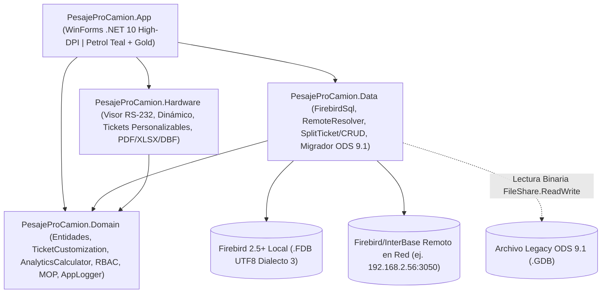

# Arquitectura Técnica — PesajeProCamion (.NET 10)

## 1. Diagrama de Capas

## 2. Proyectos de la Solución

| Proyecto | Responsabilidad |
| :--- | :--- |
| `PesajeProCamion.Domain` | Entidades de pesaje, `TicketFieldVisibility`, `TicketSplitRequest`, `TicketCustomizationHelper`, `AnalyticsCalculator`, validadores chilenos Módulo 11 y patentes (`ChileanValidators`), `WeighingCalculator`, `PasswordHasher`, RBAC (`PermissionService`) y `AppLogger`. |
| `PesajeProCamion.Data` | `RemoteDatabaseResolver` para rutas UNC de red y TCP 3050, `DatabaseCapabilities`, `FirebirdSchemaManager`, `WeighingRepository` (CRUD con neto manual, división atómica `SplitTicketAsync` y folios libres respetando `DBTRANSITO`), `SecurityRepository`, `Ods9BinaryReader` y `Ods9Migrator`. |
| `PesajeProCamion.Hardware` | Parser serial `SerialFrameParser`, `ScaleReaderService`, `DynamicAxleProcessor`, impresión gráfica/RAW y PDF de tickets personalizables por campo (`TicketPrinterService`), `PdfDocumentWriter` y exportación OpenXML `.xlsx` / `.dbf` / `.csv` (`DataExporter`). |
| `PesajeProCamion.App` | `AppTheme`, `IconCatalog`, `AppConfigStore`, `SplashForm`, `LoginForm`, `DatabaseConnectionForm`, `UsuariosForm`, `ErrorLogViewerDialog`, `VisorSetupForm`, `PesajeWorkspaceControl`, `PesajeMopForm`, `GestionPesajesControl`, `TicketEditorDialog`, `TicketViewerDialog`, `SplitTicketDialog`, `ReportsWorkspaceControl` y catálogos CRUD. |
| `PesajeProCamion.Tests` | Suite xUnit automatizada: unitarias, integración Firebird/UNC, funcionales CRUD/folios/división, auditoría UI WinForms STA y pruebas de estrés. |
